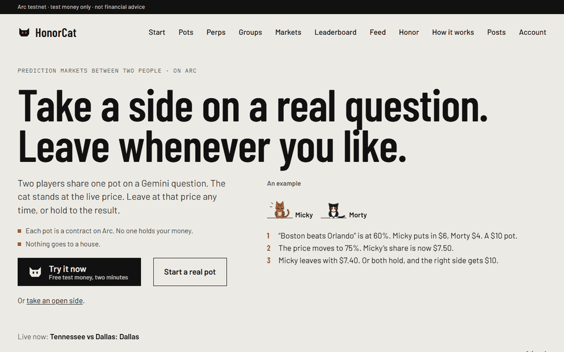
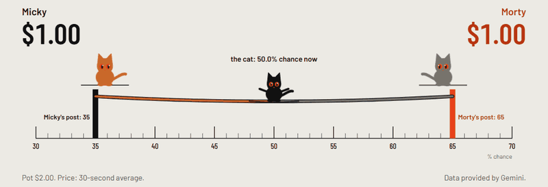
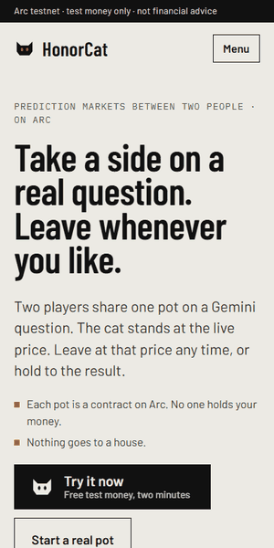
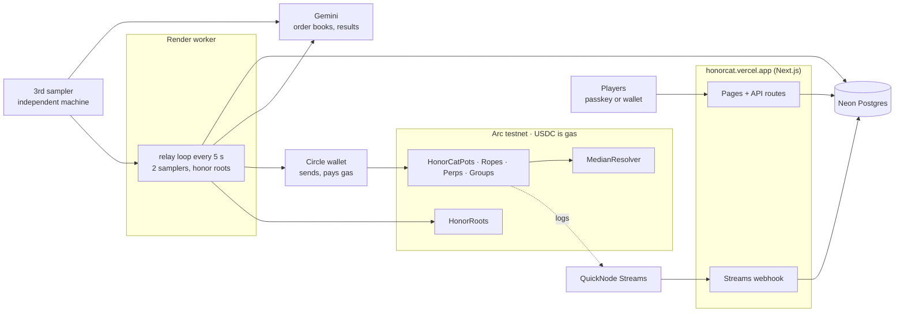

<div align="center">

# 🐈‍⬛ HonorCat

**Take a side on a real Gemini question. Leave whenever you like.**

Two players share one pot on a live Gemini prediction market, settled in USDC on Arc.
A cat on a rope stands at the live price. Leave at that price any time, or hold to the result.

**[honorcat.vercel.app](https://honorcat.vercel.app)** · [Demo route](docs/demo.md) · [Technical reference](docs/technical.md)

Arc testnet · test money only · not financial advice



</div>

---

## The idea in one picture



Each side's share **is** the price. At 56% Micky's side of a $2 pot is worth $1.40, at 49.5% $0.97.
There is no order book to fill, no counterparty to find when you want out: **leave at the 30-second
average price after you ask**, wholly or in part, and the contract divides the pot right there. If
nobody leaves, Gemini's settlement decides.

*(Sample numbers on the real `Rope` component; everything else on this page is from production.)*

## Three ways to play

| | What it is | See it live |
|---|---|---|
| **A pot** | One question, two sides, one pot. Your stake follows the price; leave at any time (1% to the side that stays) or hold to Gemini's result. Play a friend, take an open side, or practise against the practice cat. | [/pots/19](https://honorcat.vercel.app/pots/19) and its [proof](https://honorcat.vercel.app/pots/19/proof) |
| **A perp** | Short ropes on one market, one after another. Two posts close to the price give leverage (up to 10×) **without a lender**: both sides put in their whole worst case, so the pot always holds exactly what it pays. Price past a post for 30 s = knocked out, one life lost, the next rope starts at the division price. | [/perps/17](https://honorcat.vercel.app/perps/17): a new rope every hour since 19 Nov |
| **A group** | Two teams on one market. Joins and leaves are gathered for a minute and priced together, so a crowd can play one pot. Big screen with a QR code per team. | [/groups/3](https://honorcat.vercel.app/groups/3) · [big screen](https://honorcat.vercel.app/groups/3/tv) |

Around them: **Honor** (points for fair play, never for results; a daily Merkle root on Arc you can
verify in the browser), **Posts** (signed by the author, checked that they hold the side they talk
about), a leaderboard, private pots, send money to a player by name, and a big screen for every play.

<table>
<tr>
<td width="320"></td>
<td>

**Built for a phone and a first-time player.**

- Sign in with a **passkey**: no wallet app, no seed phrase, HonorCat pays the network fee.
- New players get test money and can be in a pot in **under two minutes** (measured on an iPhone viewport, pots 18 and 20).
- Every action shows its Arc fee in cents and ends in a plain receipt: *"You left at 74.5% and received $7.40."*
- Browser wallets work too, with exact approvals.

</td>
</tr>
</table>

## Why you can trust the numbers

Nothing moves without a price three independent machines agree on, and **the contract checks the agreement itself**.

```
Gemini order book ──► 3 samplers, each signs its own 30-second average (EIP-712)
                                   │
                                   ▼
          MedianResolver on Arc: median of three, or mean of two within half a point
                                   │
                                   ▼
            HonorCatRopes / Perps / Groups divide the pot at that price, in one transaction
```

- **Forward-priced.** A leave is priced over the 30 s *after* the request, never the price on screen, so nobody can pick a stale price.
- **Fully collateralised.** No margin calls, no liquidations, no debt. Shares are exact integers that always add up to the pot.
- **No house.** `OPERATOR_FEE_BPS = 0` is a constant. Every reward (maker treat, exit fee, referral) is a share of a fee another player actually paid.
- **Bounded by depth.** A pot can never exceed 0.25 × the contracts resting within 5¢ of Gemini's price, attested at creation, which caps what moving the price could earn.
- **Public evidence.** Every division has a [proof page](https://honorcat.vercel.app/pots/19/proof): each sampler's signed average, the rule, the transaction and its Memo.

What is still trusted is written down plainly in the [threat model](docs/threat-model.md): the samplers are a 2-of-3 set without a bond, and Gemini's own result decides a held pot.

## How it uses each sponsor

| | What it does in HonorCat | Check it live |
|---|---|---|
| **Arc** | USDC is the only asset, **including gas**. Create-and-fund and divide-and-pay are single transactions (Multicall3From). Every relay transaction carries a **Memo** with its reason, decoded on the pot page. Passkey smart accounts (ERC-1271, WebAuthn P-256). Arc's sub-second finality is what makes 30-second windows and one-minute group batches practical. | [/how-it-is-built](https://honorcat.vercel.app/how-it-is-built) |
| **Circle** | A developer-controlled wallet sends every passkey player's transaction and pays the fee. **Gateway**: 1 USDC deposited, $0.40 minted on Arc in 2.8 s. Send money by name ($0.03 in 2.2 s, [tx](https://explorer.testnet.arc.io/tx/0x5dd8b48febd52aa660e33039883aa36c08c167bd587c51f5aa4a315123053328)). Amounts in euros at Circle's USDC/EURC rate. | [/account](https://honorcat.vercel.app/account), [/how-it-is-built](https://honorcat.vercel.app/how-it-is-built) |
| **Gemini** | Every price is the middle of Gemini's public order book, measured by three samplers. Markets ranked by spread and depth. Gemini's settlement ends held pots. A "Trade this market on Gemini" link on every play. | [/markets](https://honorcat.vercel.app/markets) |
| **QuickNode** | **Streams** delivers our contracts' logs (9 contracts + Memo logs, filtered server-side) to a webhook within seconds, so pages and samplers react at once. An RPC poller trailing 10 blocks fills any gap. | [/status](https://honorcat.vercel.app/status), [/live](https://honorcat.vercel.app/live) |

## Proven on Arc testnet

| What | Where |
|---|---|
| Perps rolling on their own, rope after rope | Perps [17](https://honorcat.vercel.app/perps/17) and [18](https://honorcat.vercel.app/perps/18), hourly since 19 Nov |
| Knock-outs at a post on a live market, next rope at the division price | [Perp 13](https://honorcat.vercel.app/perps/13), ropes 11 and 12 (Bitcoin) |
| A group: two teams, batched joins, a priced partial leave | [Group 3](https://honorcat.vercel.app/groups/3) |
| Priced exit, takeover, handshake, bowl, held to Gemini's settlement | Pots 3–7 (`relay/scripts/pots-e2e.ts`) |
| A new visitor alone on a phone: create, rope, exit, paid in under two minutes | Pots 18, 20 (`phone-solo.mjs`) |
| Honor root posted on Arc and verified in the browser | [/honor/verify](https://honorcat.vercel.app/honor/verify) |

Full log with transactions: [docs/PROGRESS.md](docs/PROGRESS.md) · checklist with evidence: [docs/rubric.md](docs/rubric.md).

## Architecture



| Folder | What |
|---|---|
| [`contracts/`](contracts) | Solidity (Foundry): pots, ropes, perps, groups, resolvers, honor roots, passkey accounts |
| [`relay/`](relay) | TypeScript: Gemini reader, samplers, price windows, indexers, Circle, honor, posts, worker |
| [`web/`](web) | Next.js app: every page, the API, the cats |
| [`docs/`](docs) | Design notes, threat model, demo route, progress log |

## Contracts (Arc testnet, chain 5042002)

| Contract | Address |
|---|---|
| HonorCatRopes v2.1 (pots with short ropes) | [`0x5489789bDdf63903c14bFc6B96c688A94cbBB62E`](https://explorer.testnet.arc.io/address/0x5489789bDdf63903c14bFc6B96c688A94cbBB62E) |
| HonorCatPerps | [`0x286588A69173b006c2A0D868C13c47d016c90CEB`](https://explorer.testnet.arc.io/address/0x286588A69173b006c2A0D868C13c47d016c90CEB) |
| HonorCatGroups | [`0xDe28a5d9E328c09eb02A099f1480DE89E0FEb547`](https://explorer.testnet.arc.io/address/0xDe28a5d9E328c09eb02A099f1480DE89E0FEb547) |
| HonorCatPots v1 | [`0xc890C990048f45cb268d076E4A3dB25270Ea1e59`](https://explorer.testnet.arc.io/address/0xc890C990048f45cb268d076E4A3dB25270Ea1e59) |
| MedianResolver (ropes and perps / groups / v1) | [`0xe554…B3`](https://explorer.testnet.arc.io/address/0xe554955192C3f0F0472920d4e70B2f8cA38817B3) · [`0x1c95…eE`](https://explorer.testnet.arc.io/address/0x1c952c9d7912c09135317B697c90224CA1BBc0eE) · [`0x62FB…62`](https://explorer.testnet.arc.io/address/0x62FB60fbB5fC1903A4af3dc61186C2ed7f153c62) |
| HonorRoots (daily honor Merkle roots) | [`0xd8A60838eD1AA25285a86bE7DDf589676c189c5C`](https://explorer.testnet.arc.io/address/0xd8A60838eD1AA25285a86bE7DDf589676c189c5C) |
| HonorCatFairValue (a side's value from a signed quote) | [`0x8a890a0A79371333dEaAF1aFC76D68ffDc7671a5`](https://explorer.testnet.arc.io/address/0x8a890a0A79371333dEaAF1aFC76D68ffDc7671a5) |
| PasskeyAccountFactory | [`0xB93e6C63815Af25213c43dEc1B494452c8ED0ea2`](https://explorer.testnet.arc.io/address/0xB93e6C63815Af25213c43dEc1B494452c8ED0ea2) |
| Circle relay wallet | [`0xf1eb955bd6329285e39c87ade8199c9750bff569`](https://explorer.testnet.arc.io/address/0xf1eb955bd6329285e39c87ade8199c9750bff569) |

Every deployment, including retired ones: [`deployments/`](deployments) and the [technical reference](docs/technical.md#contracts-on-arc-testnet-chain-5042002).

## Run it

Requirements: Node 22+, pnpm 10, Foundry.

```bash
pnpm install
cp .env.example .env              # secrets only in env vars, never in the repo
pnpm web dev                      # http://localhost:3000 (without DATABASE_URL it uses an embedded PGlite)
cd relay && npx tsx --env-file=../.env scripts/sampler.ts --key-env SAMPLER_KEY_LOCAL   # a sampler
```

```bash
cd contracts && forge test                    # unit, fuzz and invariant tests (199)
pnpm --filter @honorcat/relay test            # relay, samplers, groups, honor, posts (210)
cd web && npx tsc --noEmit && npx eslint src
```

Every switch, variable and deploy step: [technical reference](docs/technical.md#setup).

## Honest limits

- **Testnet only.** Real-money use would need legal review.
- The three samplers are a trusted 2-of-3 set: no bond or slashing yet. Two colluding samplers could sign a wrong price; one refusing only delays.
- Thin markets: when Gemini's book is too wide, the samplers correctly give no price and nothing moves (exits wait, funds stay safe).
- Jumps past a post are paid at the post, which slightly favours one side near 0 or 100. Measured in the [rope backtest](docs/technical.md#v2-short-ropes-and-treats); ropes end at least 2 hours before a market closes to limit it.

---

<div align="center">

Data provided by Gemini. Prices can be off when few people trade a market.

**Fair prices. Paid on Arc.**

</div>
