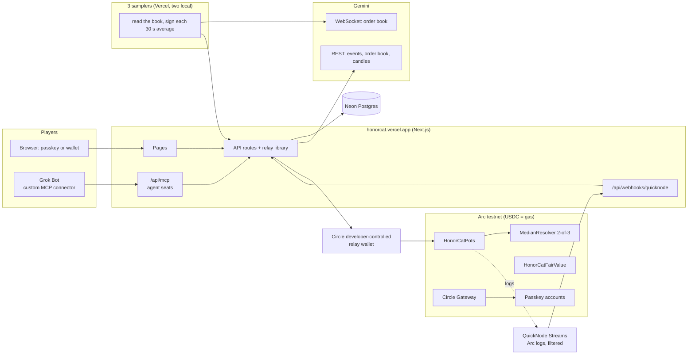

# HonorCat

**A pot between two sides on a Gemini prediction market, settled in USDC on Arc.** One side holds a
plain statement ("Baltimore beats Los Angeles Chargers"), the other its opposite. Each side's share
follows the market price, and either side may leave at any time at a fair, forward-priced value. If
nobody leaves, Gemini's settlement decides and the side that was right receives the pot. Fully
collateralised, no leverage, no operator access to funds. Testnet only, test money only, not
financial advice.

Live: **https://honorcat.vercel.app**

## Contents

- [What it does](#what-it-does) · [Architecture](#architecture) · [Contracts](#contracts-on-arc-testnet-chain-5042002)
- [Economic design and its risks](#economic-design-and-its-risks) · [v2: short ropes and treats](#v2-short-ropes-and-treats) · [How HonorCat uses Arc](#how-honorcat-uses-arc)
- [The QuickNode Stream](#the-quicknode-stream) · [Grok Bot](#grok-bot) · [Every asset and Circle product](#every-asset-and-circle-product)
- [Setup, run, test, deploy](#setup) · [Environment variables](#environment-variables) · [Build log](#build-log) · [Handoff](docs/HANDOFF.md)

## What it does

| Page | What |
|---|---|
| [`/`](https://honorcat.vercel.app) | A worked example, one live pot on the rope, open offers |
| [`/pots/new`](https://honorcat.vercel.app/pots/new) | Start a pot: a market as a statement and its opposite, your side, only your own amount (the pot follows from the price); practise alone against the practice cat or your Grok Bot |
| [`/pots`](https://honorcat.vercel.app/pots), [`/pots/together`](https://honorcat.vercel.app/pots/together) | Your pots and open offers; a pot started together with a friend |
| `/pots/<id>` | The rope between two posts (each player's cat on its post, the market cat at the 30-second price, nets, bowls, the paw trail), three large amounts, the exit with its confirmation and summary, handshake, the price chart with every event marked, the story, every measured window |
| `/pots/<id>/tv`, `/terms`, `/proof` | Big screen; the code of honor and the pot's terms; contract, rule, evidence |
| `/record/<address>` | Honor record: the facts and plain labels read from them, no score |
| [`/grok-bot`](https://honorcat.vercel.app/grok-bot) | How to invite your Grok Bot as an AI opponent or cat sitter |
| [`/how-it-is-built`](https://honorcat.vercel.app/how-it-is-built), [`/status`](https://honorcat.vercel.app/status) | Arc, Gemini, QuickNode, Grok Bot and Circle with live evidence; relay and Streams health |
| [`/markets`](https://honorcat.vercel.app/markets), [`/live`](https://honorcat.vercel.app/live), `/how`, `/developers`, `/account` | Market quality; Streams deliveries; how it works; contracts and API; My money: the balance (in $ or €), then Add money (from another chain, or card or bank as a marked demo), Send (to a player by name) and Withdraw, and Grok Bot seats |

End-to-end runs against production (testnet USDC):

| Run | Pot | Result |
|---|---|---|
| `pots-e2e.ts --scenario exit / takeover / handshake / bowl / hold` | 3 to 7 | priced exit, takeover at the exit price, handshake, a bowl filed by the samplers, held to Gemini's settlement |
| `pots-quote.ts` | 2 | a signed quote valued both sides on-chain through HonorCatFairValue |
| `pots-e2e.ts --scenario together` | 10 | two friends, shared draft, guest agreed, host opened, guest put in |
| exits with the rule on-chain | 8, 9 | priced by the MedianResolver from three signed averages; pot 9 ran while Streams was paused |
| `pots-wallet-e2e.ts` | 12 | a plain browser wallet, exact approvals and ordinary transactions |
| `phone-solo.mjs` (iPhone viewport, new passkey) | 18, 20 | a new visitor alone: create, rope, exit, paid out in under two minutes |
| `agent-play-e2e.ts` | 24 | a Grok Bot seat over MCP took the other side, set a net and left, each with its reason |
| `agent-play-e2e.ts --sitter` | 25 | the cat sitter's net became a proposal; the full exit signed in advance went through alone |
| `gateway-e2e.ts` | – | Circle Gateway: attestation and mint on Arc by the Circle relay wallet |

## Architecture



- **web/**: Next.js app on Vercel: pages, API routes, the MCP endpoint, and the relay running inside
  Vercel functions (ticks driven by traffic and the Streams webhook).
- **relay/**: the shared library: Gemini reader (`gemini.ts`), market catalogue (`catalog.ts`),
  pots relay (`pots.ts`: windows, attestations, indexing, evidence), samplers (`potsSampler.ts`),
  agent seats and the cat sitter (`agentSeats.ts`, `catSitter.ts`), Circle (`circleWallet.ts`,
  `gateway.ts`), funding, names, notes, push, database (`db.ts`).
- **contracts/**: Solidity (Foundry): `HonorCatPots`, `MedianResolver`, `HonorCatFairValue`,
  `MultisigResolver`, passkey accounts; retired sources in `contracts/archive/`.
- **docs/**: the pot design (`pot-design.md`), threat model, specs (`polish-spec.md`,
  `grokcat-spec.md`), progress (`PROGRESS.md`) and the checklist (`rubric.md`).

## Contracts on Arc testnet (chain 5042002)

| Contract | Address | Purpose |
|---|---|---|
| **HonorCatPots** | `0xc890C990048f45cb268d076E4A3dB25270Ea1e59` | The two-sided pot: create and fund, forward-priced join and exit, partial exit, handshake, nets and bowls, takeover, settle, expire; sides as ERC-721 (`HCSIDE`) |
| **HonorCatRopes** (v2) | `0x6A30Bc4F1867A4441Ac2e7e1e77Cb40E79F9Cf44` | Pots with short ropes (leverage), knock-out, expiry, extra lives and treats; holds every v2 dollar; sides as ERC-721 (`HCROPE`). New pots move here when `ROPES_FOR_NEW_POTS=true` |
| HonorCatRopesExtension (v2) | `0x97E685CD710BdED0B15825D41275e1FEcc4D85Be` | Code HonorCatRopes runs by delegatecall (24 KB limit); holds nothing |
| MedianResolver (v2) | `0x3f73b5925060653d80665CD61512C1B448585842` | The same agreement rule, for HonorCatRopes |
| **MedianResolver** | `0x62FB60fbB5fC1903A4af3dc61186C2ed7f153c62` | The samplers' signer set with the agreement rule on-chain (median of three, mean of two within half a point); pots 8 and later |
| **HonorCatFairValue** | `0x8a890a0A79371333dEaAF1aFC76D68ffDc7671a5` | Stateless reader: a side's value from a signed quote window |
| MultisigResolver | `0x81d1194069E1aD3a22C17356065d8dF6A4D436c9` | 2-of-3 ERC-1271 signer set (pots 1 to 7, depth and outcome attestations) |
| PasskeyAccountFactory / implementation | `0xB93e6C63815Af25213c43dEc1B494452c8ED0ea2` / `0xCe60d5aF6F912f0565092A139FEF1bC764b32c65` | Passkey (WebAuthn P-256) accounts for players |
| Circle relay wallet | `0xf1eb955bd6329285e39c87ade8199c9750bff569` | Circle developer-controlled wallet (Circle holds the key): sends every pot transaction, funds new players, plays the practice cat and agent opponents |
| Circle GatewayWallet / GatewayMinter | `0x0077777d7EBA4688BDeF3E311b846F25870A19B9` / `0x0022222ABE238Cc2C7Bb1f21003F0a260052475B` | Circle's: one USDC balance across chains, minted on Arc |
| Arc USDC (system) | `0x3600000000000000000000000000000000000000` | The only asset, also gas |
| Memo (Arc system) | `0x5294e9927c3306dcbadb03fe70b92e01ccede505` | Carries the reason of every relay transaction |
| Multicall3From / CallFrom (Arc system) | used through `txs.ts` | Batched calls that keep the original sender |

Samplers: `0x5342D175f4d94803A15D8263631619F0a87Ce7d9` (Vercel), `0x495E8D129013C586f0F285f7DDaDcA396d574557`,
`0x75E23319786FF759A5210C638C4F33c230Ac9CD7` (local). Retired, read-only: VerdictVault
`0xba7190441bc00fC1AC8597d68197039e1167E6D4`, GuaranteeBook `0x2C59F2973F67e5Adf1aC4eDCfEF7F6D800746774`,
BatchGuard `0xf040cb9bc88539E567A0552b082a011c21208AEE`, MerkleBook `0x308b6b2e24C3676824aC64226883F8295d9E867e`.
Records: `deployments/5042002*.json`.

## Economic design and its risks

**Deposits.** A pot of size N splits by the YES price p: the YES side's share is N·p, the NO side's
N·(1−p). The creator enters only their own amount; the pot follows from the price. Because the join
is priced later (below), the creator escrows its worst case within a band (up to 5 points around the
accepted price) and the joiner does the same; the entry price is the 30-second average that starts
right after the join request, and anything either side put in above its share is returned in the
same transaction. If the price leaves the band or cannot be measured, the join does not happen and
the joiner gets everything back. So nobody starts ahead: the favourite costs more.

**Exits.** Either side may leave at any time, wholly or in part (nine lives = ninths). The request is
binding and the price is the 30-second average that starts *after* it, never the price on screen, so
a fast player cannot pick a stale price. The window needs at least 10 valid readings of Gemini's book
(spread and size rules per market); otherwise nothing moves and the pot continues, with a two-minute
cooldown. Exits close a few minutes before the market's close (the lockout). Someone else may take
over the leaving side at the exit price. A handshake divides at a price both sides sign, with no fee.
A net or bowl files an exit when the side's own average holds at the level for a full window.

**The fee.** The leaving side pays 1% of the divided amount to the side that stays ("a treat for the
other cat"). It discourages flipping in and out on noise and pays the stayer for the uncertainty.
HonorCat takes nothing.

**The cap tied to market depth.** A pot may not exceed $0.25 per contract resting within 5 cents of
the price (`CAP_PER_CENTI_CONTRACT`), attested by the samplers at creation; on testnet also $25. A
pot can then never be large relative to the book that prices it, which limits the profit from pushing
Gemini's price during an exit window.

**What the samplers can and cannot do.** Three independent samplers read Gemini's order book and each
signs its own average; the MedianResolver takes the median of three (or the mean of two within half a
point) on-chain. They can: price joins, exits, nets, bowls and quotes, attest depth, and attest
Gemini's result. They cannot: move funds anywhere but the pot's own two sides, change a pot's terms,
or pay themselves. Two colluding samplers could sign a wrong price; one refusing to sign only delays
things (exits fail safe, the deadline refunds both deposits).

**What remains unsolved.** The samplers are a trusted 2-of-3 set (no economic bond or slashing yet);
Gemini's prices can be thin or manipulated within a window, which the depth cap only bounds; the
settlement trusts Gemini's own result via the samplers; the relay and samplers must be live for
prices (funds stay safe without them, but exits wait); and real-money use would need legal review.

## v2: short ropes and treats

Design note and decisions: [docs/rope-design.md](docs/rope-design.md), [docs/PROGRESS.md](docs/PROGRESS.md).
Contract: `contracts/src/HonorCatRopes.sol` (+ `ropes/`). Existing v1 pots stay on HonorCatPots.

**The rope has two posts.** A pot has a lower post L and an upper post U around the entry price q. YES
puts in (q − L) per contract, NO puts in (U − q); the pot holds (U − L). At any price p, YES's share is
clamp(p, L, U) − L and NO's is the rest. A normal pot is L = 0, U = 100. A post close to q is leverage:
at 50 with L = 40, YES's stake doubles on a 10-point move (5×), and is gone if the price holds at 40.

**Why it needs no lender.** Nobody borrows. Both sides put in their whole worst case before the pot
starts, so the pot always holds exactly what it can pay: the contract only ever divides that pot, at
a price clamped to the posts. No side can lose more than its deposit and nothing is ever owed; there
is no margin call, no liquidation auction and no debt to collect. The clamp is what replaces the
lender: past a post the game is simply over. Shares are exact integers (price ticks of 0.01 points ×
hundredths of a contract = USDC base units), so the two shares always add up to the pot.

**How a short rope ends.** By *knock-out*: the samplers' smoothed price holds at or beyond a post for
a window; anyone may submit that attestation; the pot is then priced over the next window, like every
exit, divided at the clamped price, and ends (no fee). Or at its *expiry*, at most 7 days away and at
least 2 hours before trading closes, priced over a window fixed by the expiry itself, so nobody can
choose it (three fixed retries if the market has no valid price). A short rope never runs into
Gemini's result. *Extra lives* move a side's own post one rope length further out (up to 8); the
other side's share stays the same or grows at every price.

**Two known weaknesses, and what limits each.**
1. *Overshoot on jumps.* The linear deposits are exactly fair only if overshoot past U and past L
   are equally likely: the fair YES deposit is (q − L) − E[overshoot above U] + E[overshoot below L].
   A jump past a post pays the clamped amount, so near 0 or 100 (where jumps can only go one way far)
   the side whose post faces the open end is favoured. Limits: ropes end at least 2 hours before
   close (most jumps come at resolution), a 5-point minimum distance (at least twice the spread),
   leverage at most 10× on crypto and 5× elsewhere, and division at a 30-second forward average
   rather than a tick. Measured below.
2. *Cheaper manipulation near a post.* Moving the price 5 points costs less than moving it 50. The cap
   ties the pot to the book: size ≤ 0.25 × the contracts resting within 5¢ on the thinner side
   (attested by the samplers at creation). With Gemini's taker fee (0.07 · C · P(1−P), 2026-03-18
   schedule; the maker promotion does not lower an attacker's cost), pushing the price Δ and holding
   it through the trigger and the forward window costs at least C₅·(Δ/2 + 0.14·P̄(1−P̄)) against a
   gain of N·Δ; requiring cost ≥ 2 × gain gives N ≤ C₅·(1/4 + 0.07·P̄(1−P̄)/Δ), so 0.25 × C₅ holds at
   every price. Its weak spot is the assumption that depth is spread evenly over the 5¢; the
   **refinement** (documented, not built) is for the samplers to attest the actual cost of walking the
   full book to each post and the contract to enforce 2·N·Δ_post ≤ cost_post for both posts.

**Treats: every reward is a share of a fee someone actually paid.** Nothing is minted, there is no
sponsor and no prize pool, and `OPERATOR_FEE_BPS = 0` is a constant: no fee goes to HonorCat, and no
rate can be changed after deployment.

| Treat | Who pays | Who gets it |
|---|---|---|
| Maker treat 0.25% | the joiner, on its deposit | the player who opened the pot |
| Exit fee 1% of the pot value exited | the side that leaves | the side that stays (no fee on knock-out, expiry or handshake) |
| Referral 20% of every fee, first 20 pots | (taken from the fee above) | the player who invited the payer (set once, before the first pot) |
| Copycat 5% of profit | a player who marked its side as a copy, only if it ends in profit | the player copied |

*Why it cannot be farmed:* a treat is always part of a fee the payer would pay anyway, so no sequence
of actions creates money. Opening and joining your own pot moves your own money. Copying yourself pays
yourself out of your own profit. The contract rejects referring yourself. The honest exception: with
free accounts a player can refer a second account of their own and get 20% of their own fees back for
20 pots. That is a fee discount paid by the counterparty (who then receives 80% of the fee), never a
profit. The copycat treat is held back (5% of each payout) until the copy ends, so a profit followed
by a loss pays no treat.

**Backtest and simulation** (`relay/scripts/rope-backtest.ts`, results in `docs/backtest/rope-backtest.json`;
bias = fair YES deposit minus the linear one, in points; positive = YES favoured):

| Source | Setting | Upper post first (linear rule says 50%) | Mean overshoot past the post | Bias |
|---|---|---|---|---|
| Simulation, small moves only | entry 50 or 80, 5–10-point posts, 72 h to 0.5 h before resolution | 41–53% | 0.1–0.8 points | within ±0.5 |
| Simulation, small moves + jumps | entry 50 | 48–52% | 0.9–2.0 points, both sides | within ±0.4 (symmetric) |
| Simulation, small moves + jumps | entry 80, 72–24 h before resolution | 40–55% | below L 0.9–2.0, above U 0.3–0.7 | +0.2 to +0.8 |
| Simulation, small moves + jumps | entry 80, 6–0.5 h before resolution | 57–62% | below L up to 2.8, above U 0.8 | +0.7 to +2.4 |
| Model-based BTC daily contracts (Gemini 15-minute candles, 4–18 Nov 2026) | 5 / 10 / 20-point posts, ending 2 h before close | 41% / 34% / 24% | below L 2.4–3.9 | −0.6 / −2.9 / −8.9 |

What it shows: on its own the clamp is fair when the entry is near 50; the bias comes from jumps when
the entry is near 0 or 100, and it grows as the rope gets closer to resolution, which is why ropes end
at least 2 hours before close (at that limit, 10-point posts at 80 still carry about 1.6 points). The
BTC rows come from one fortnight in which BTC fell, measured with 312 overlapping daily windows: a
trend in the sample, not a structural bias, and model-based rather than market-observed. The recorded
Gemini midpoints (`relay/scripts/record-mids.ts`, recording since 18 Nov, live NBA/NHL games kept
separate) are added to the JSON as they accumulate; the production sampler history before 16 Nov was
lost when the database was rebuilt, so there was no older record to use.

## How HonorCat uses Arc

- **USDC as gas.** Players hold only USDC; HonorCat's relay pays the network fee in USDC for passkey
  players (Circle relay wallet), browser wallets pay their own fraction of a cent.
- **Joins and exits by signature.** Passkey accounts are ERC-1271 smart accounts; the relay forwards
  their WebAuthn-signed calls. Exits can be signed in advance (`requestExitFor`, EIP-712), which is how
  a cat sitter can leave alone on the player's behalf without ever holding a key.
- **Single-transaction create-and-fund and divide-and-pay.** `create` pulls the escrow and opens the
  pot in one transaction; `resolveExit` / `resolveJoin` / `settle` price, divide and pay both sides in
  one transaction, with Multicall3From batching the approval and the call where needed.
- **Memos.** Every relay transaction carries a Memo with the pot and the reason (exit price, window,
  agreement rule, an agent's reason); the pot page decodes it from the chain.
- **Funding from other chains.** Circle Gateway's unified balance (deposit on seven chains; once confirmed, spend it into an HonorCat account
  on Arc with one signature).
- **Fees in plain words.** Every action shows its Arc network fee in cents next to it, and every payout
  becomes a receipt sentence ("You left at 74.5% and received $7.40.") with how long it took and the
  transaction that carries its Memo.

## The QuickNode Stream

- **Network** `arc-testnet`, **dataset** `logs`, from block 72,359,797, no end, batch size 1 (the plan's
  limit), region US East.
- **Filter** (`relay/src/indexer/quicknode.ts`, uploaded by `relay/scripts/quicknode-stream.ts --filter`):
  keeps only logs from our contracts (HonorCatPots and the retired ones) plus Memo logs of the same
  transactions, drops empty blocks except every 20th as a heartbeat.
- **Destination**: webhook `https://honorcat.vercel.app/api/webhooks/quicknode`, verified with the
  stream's security token (`QUICKNODE_STREAMS_TOKEN`).
- **Why**: pot events arrive within a second or two of their block, so pages update and samplers start
  measuring at once, without polling Arc. Streams is the first source; an RPC poller trailing the head
  by 90 blocks fills any gap. /status shows the share first seen by Streams (34 of 34 since the stream
  resumed on 2026-11-16).

## Grok Bot

Grok Bot, xAI's always-on agent, connects to HonorCat as a custom MCP connector: on `/grok-bot` a
player confirms once and copies one message that gives the Bot its connector link (`/api/mcp/<seat>`,
the seat in the address, nothing else to fill in) and its job; the seat expires after 24 hours and can
be revoked at any time. With a seat it can be the player's AI opponent
on practice pots (holding the other side with HonorCat's practice wallet) or a cat sitter on the
player's own pots, acting alone only on exits the player signed in advance and proposing nets, bowls
and handshakes for the player to confirm. Every action is checked against the seat's action list,
limits and powers, logged with the agent's one-line reason, and shown on the pot page. It runs on the
player's own Grok Bot plan and never holds a key or withdraws.

## Every asset and Circle product

What each does for the player, and where to check it live (`/how-it-is-built` shows the current
counts, rates and newest transactions from `/api/hc/evidence`).

| Asset or product | What it does for the player | Live evidence |
| --- | --- | --- |
| USDC | The money in every pot, payout and fee; on Arc also the gas, so no second token | Payouts (`Paid` events) with the newest transaction |
| EURC | Amounts shown in euros at a stated rate for players who choose euros (display only; pots pay USDC) | The live rate, e.g. 1 USDC = 0.909 EURC |
| Circle Developer-controlled Wallets | The relay wallet whose key Circle holds sends every passkey player's action and pays the fee | Transactions sent by Circle, newest linked |
| Circle Gateway (unified balance) | Deposit USDC on Base, Ethereum, Avalanche, Arbitrum, Optimism, Polygon or Arc; spend it into the HonorCat account on Arc with one signature (the Arc multichain wallet sample's flow, the Unified Balance Kit's deposit / getBalances / spend) | Gateway mints on Arc, newest linked |
| Circle Stablecoin Kits rates (Swap Kit `getTokenRates`) | The USDC/EURC rate behind euro amounts | Rate and the time Circle priced it |
| Circle CCTP V2 | Built earlier for USDC from Solana Devnet and six EVM testnets (`/api/cctp/receive`); the current pages use Gateway for this job | Not on the current pages |
| Sends between players | Send USDC to another player by name (cat and short address confirmed); "send my share" after a pot | Count, total and newest send |
| Circle Modular Wallets | Built (passkey smart accounts, gas sponsored); switches on once the Circle console is set up | Not live yet |
| Circle Onramp Kit | Add money by debit card or bank transfer (the USDC Onramp Demo sample's steps) | A marked demo on /account: needs a Circle API key, and the sandbox cannot settle on Arc testnet |
| Earn, Bridge on exit, EURC payouts | Need a Circle smart account per player | Not built yet |

## Setup

Requirements: Node 22+, pnpm 10, Foundry (for contracts).

```bash
pnpm install
cp .env.example .env          # fill in; secrets only in env vars, never in the repo
```

## Run

```bash
pnpm web dev                                   # the app on http://localhost:3000
cd relay && npx tsx --env-file=../.env scripts/sampler.ts --key-env SAMPLER_KEY_LOCAL   # a local sampler
```

Without `DATABASE_URL` the relay uses an embedded PGlite database in `.data/`.

## Test

```bash
cd contracts && forge test                     # pots (v1 and v2 ropes), resolvers, fair value, passkey accounts
halmos --contract RopesMathSymbolic             # symbolic checks (time out without a counterexample)
cd relay && npx tsx scripts/rope-backtest.ts   # backtest and simulation (aggregates only)
cd relay && npx tsx --env-file=../.env scripts/ropes-e2e.ts --scenario short   # v2 on Arc testnet
pnpm --filter @honorcat/relay test             # relay, catalogue, samplers, agents, names, messages, statements
cd web && npx tsc --noEmit && npx eslint src && npx next build
cd relay && npx tsx scripts/agent-seat-e2e.ts  # agent seats against production (moves no money)
```

## Deploy

- **Web and relay**: `npx vercel deploy --prod --yes` from the repository root (project "verdict").
- **Samplers**: one inside the app, two local (`scripts/sampler.ts`).
- **Contracts**: `forge script script/<Deploy…>.s.sol --rpc-url $ARC_RPC_URL --broadcast`; records in `deployments/`.
- **Database**: a fresh database is rebuilt from public sources with `relay/scripts/rebuild-db.ts`.
- **Stream**: `relay/scripts/quicknode-stream.ts` (`--filter`, `--status active`, `--url …`).

## Environment variables

| Name | Where | Purpose |
|---|---|---|
| `ARC_RPC_URL`, `ARC_CHAIN_ID`, `USDC_ADDRESS` | Vercel, local | Arc testnet |
| `DATABASE_URL` | Vercel (local: optional) | Neon Postgres; empty = PGlite |
| `CIRCLE_API_KEY`, `CIRCLE_ENTITY_SECRET`, `CIRCLE_RELAY_WALLET_ID`, `CIRCLE_RELAY_WALLET_ADDRESS` | Vercel, local | The Circle relay wallet |
| `NEXT_PUBLIC_CIRCLE_CLIENT_KEY`, `NEXT_PUBLIC_CIRCLE_MODULAR_READY` | Vercel | Circle smart accounts in the browser |
| `RESOLVER_ADDRESS`, `SAMPLERS`, `SAMPLER_KEY*` | Vercel / local | The samplers |
| `QUICKNODE_STREAMS_TOKEN`, `QUICKNODE_API_KEY`, `QUICKNODE_STREAM_ID` | Vercel / local | Streams |
| `VAPID_*` | Vercel | Push notifications |
| `XAI_API_KEY` | Vercel (optional) | GrokCat in the app, if xAI credits exist; without it the helper cat uses templates |
| `RELAY_PRIVATE_KEY`, `DEPLOYER_PRIVATE_KEY` | local / Vercel | Retired products; deployments |
| `ROPES_FOR_NEW_POTS` | Vercel | `true`: the create page offers short ropes and new pots go to HonorCatRopes (v2). Default off |
| `NEXT_PUBLIC_GEMINI_LINK_QUERY` | Vercel (optional) | A query added to links to Gemini's market pages (e.g. a referral code); none by default |

## Data and honesty

Prices are Gemini market data, credited "Data provided by Gemini" wherever a price appears. Markets can
be wrong. Testnet only, test money only, not financial advice.

## Build log

Built from 2026-11-13 to 2026-11-17 (git log for every step).

- **2026-11-13** (4 commits): monorepo; VerdictVault with EIP-712 resolution; Arc deploy script; Next.js on Vercel.
- **2026-11-14** (39 commits): relay (sources, signer, resolver, indexers), API routes, first end-to-end
  run; vault on Arc; gasless funding (EIP-3009), ERC-1271 multisig resolver; QuickNode Streams pipeline;
  GuaranteeBook with memos and Multicall3From batching.
- **2026-11-15** (64 commits): HonorCat brand; passkey accounts; MerkleBook; the early-payout trigger
  engine with three samplers and 2-of-3 signing; the design system; CCTP funding; the market catalogue.
- **2026-11-16** (morning): the two-sided pot: cleanup C1, design D0, HonorCatPots D1 (invariants,
  Slither), relay D2, pages D3/D4, honor record and evidence D5, MedianResolver, FairValue, end-to-end runs.
- **2026-11-16** (afternoon): pots with a friend; browser wallets without risk warnings; markets with
  Gemini artwork; automatic test money; Circle relay wallet and Gateway; the polish spec P1 to P10
  (practice cat, your own cat, statements and three amounts, the rope, exits that explain themselves,
  code of honor, a cat in every state, QR invitations and link previews, plain messages, accessibility).
- **2026-11-16** (evening): the database moved to a new free Neon project and rebuilt from the chain;
  the helper cat; Circle smart accounts (built, waiting for the console setting); the price chart;
  Grok Bot as an MCP connector (AI opponent and cat sitter) with end-to-end runs; Streams back to 100%.
- **2026-11-17**: everyday use: fees in cents and receipt sentences with payout times; send money to
  another player by name and "send my share" after a pot; a home currency (euros at Circle's stated
  rate); Gateway funding in the unified-balance wording; every asset and Circle product with live
  evidence; links from every market to its page on Gemini; Onramp as a marked demo; My money rebuilt
  around the balance with add, send and withdraw one at a time.
