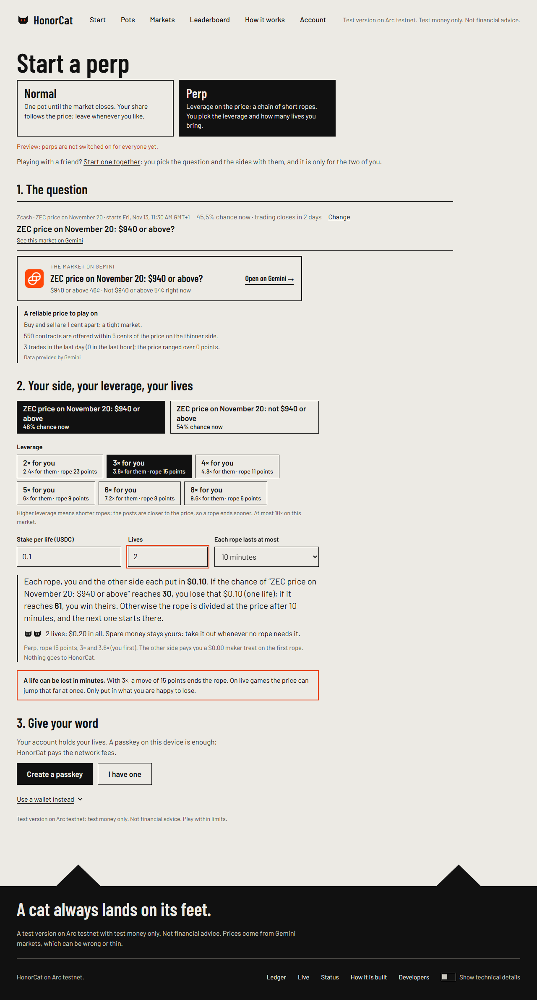
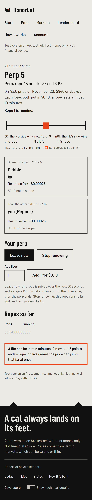
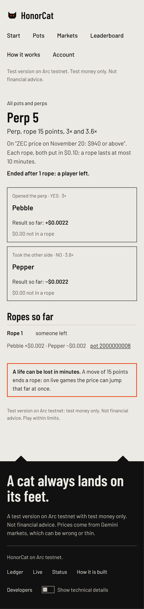

# HonorCat perps: how we tested them

Everything below ran on **Arc testnet** with test USDC, against the deployed contracts and the live
app at https://honorcat.vercel.app. Every claim links to its transaction on Arc's explorer.

- HonorCatPerps (the chain of ropes): `0x286588A69173b006c2A0D868C13c47d016c90CEB`
- HonorCatRopes v2.1 (each rope is one of its pots): `0x5489789bDdf63903c14bFc6B96c688A94cbBB62E`
- Explorer: https://explorer.testnet.arc.io

Amounts are in USDC base units (1,000,000 = $1). The test stakes were tiny on purpose.

## What a perp is, in one paragraph

Two players take opposite sides of a Gemini prediction market with leverage. The perp is a chain
of short ropes: each rope has two posts the same distance either side of the price, and both players
put in the same stake. If the price reaches a post, the rope ends at once and one side loses its
stake (one life). Otherwise the rope ends after its rope life and is divided at the price then. Each
time, the next rope starts at that price, in the same transaction, for as long as both have lives
left. Prices come from three independent samplers reading Gemini's order book; the contract accepts
a price only when the median of their signed averages agrees.

## Results at a glance (18 November 2026)

| What had to work | Result | Proof |
|---|---|---|
| A chain of at least three ropes | passed | perp 1: three ropes, each rolled into the next |
| A rope ending at its expiry, divided at the measured price | passed | perps 1, 2, 4 |
| The next rope starting at the division price in the same transaction (roll after an expiry) | passed | perp 1, ropes 2 and 3 |
| Ending when a player runs out of lives | passed | perp 2 |
| Ending by "leave now" (exit fee of 1% to the other side) | passed | perps 3 and 5 |
| Ending by "stop renewing" | passed | perps 1 and 4 |
| Maker treat (0.25% of the stake) paid to the creator on the first rope | passed | perps 1 to 4 |
| Everything through the real pages, two passkey accounts, no wallet | passed | perp 5 |
| A knock-out at a post, and a roll after a knock-out | pending: runs on live NHL and NBA games tonight (00:40 and 02:40 UTC) | below, once run |

Automated tests as of today: **183 contract tests** (unit, fuzz, invariant and symbolic; 0 failing)
and **160 relay and interface tests** (0 failing).

## Run 1: four perps on one market, driven by scripts

Market: "ZEC price on November 20: $940 or above" (Gemini, about 45%). Rope: 6 points either
side of the price (8.2× and 8.5×), stake 6,000 per rope ($0.006), rope life 10 minutes. Two fresh
wallets opened and joined; **everything else was done by the relay and the samplers**: starting the
first ropes, pricing them, dividing them at expiry and rolling them.

### Perp 1: a chain of three ropes, then "stop renewing"

| Step | What happened | Transaction |
|---|---|---|
| Open, 9 lives | budget 54,000 | [0x3776…4f22](https://explorer.testnet.arc.io/tx/0x377646ecc60dd7106e685ef48ed5ed4ce79640294f74ef613cddf66501dc4f22) |
| Join, 9 lives + maker treat | budget 54,015 | [0xe9d8…e92e](https://explorer.testnet.arc.io/tx/0xe9d8c798fbe888ec6c1b9111872c9e1fa4619936f5cc07a26f1c9b2f7f9ee92e) |
| Rope 1 starts (relay) | priced over 30 seconds after the request | [0x00de…f529](https://explorer.testnet.arc.io/tx/0x00de99ec207418184cc77c633daf856ab8f23e6b0ceff08efd6dd0c7ef2cf529) |
| Rope 1 expires, rope 2 starts at its price | one transaction | [0x12a7…feb0](https://explorer.testnet.arc.io/tx/0x12a7ab0efb255b774498e8d1dea36d0b2d3ae8247166f756a63760387210feb0) |
| Rope 2 expires, rope 3 starts at its price | one transaction | [0x3cef…76c5](https://explorer.testnet.arc.io/tx/0x3cefd4a795f41d7b624582b1d0b86c9fae3c62073ee9511a6647339bd93e76c5) |
| A stops renewing | | [0x12f8…3a41](https://explorer.testnet.arc.io/tx/0x12f8ab6cfb79ab89abd6181e0207280b5e1123cebac49c6dc69808c444d63a41) |
| Rope 3 expires, perp ends ("renewal switched off") | | [0x6331…acbc](https://explorer.testnet.arc.io/tx/0x6331259e61c65c35c4ecfc0863731289032f0ba401751aa5807f682a8967acbc) |

### Perp 2: one life each, ended by running out of lives

| Step | What happened | Transaction |
|---|---|---|
| Rope 1 expires, rope 2 starts | the price had not moved: both got their 6,000 back | [0x3da5…e112](https://explorer.testnet.arc.io/tx/0x3da579cfd288fa98343dcc6d1a2939dca0ce09ee03554eb42d13c3194347e112) |
| Rope 2 expires, perp ends | ZEC moved 2.5 points: A 8,500, B 3,500. B has less than one stake left, so "a player ran out of lives" | [0x4f1d…5307](https://explorer.testnet.arc.io/tx/0x4f1da3a179f2714f2e5299c4883448cf18bfef15e5f183b5306a184eef4f5307) |

### Perp 3: ended by "leave now"

| Step | What happened | Transaction |
|---|---|---|
| A leaves now | 6 seconds after rope 1 started | [0xfd65…e004](https://explorer.testnet.arc.io/tx/0xfd6521fbc000dc29966ba91a54f786aa16f56c18a2fc517d670817e1464ae004) |
| Rope priced over the next 30 seconds, perp ends | A 5,880, B 6,120: the leaver paid 1% of the 12,000 rope (120) to the other side | [0x4f63…3c43](https://explorer.testnet.arc.io/tx/0x4f63273ea563a85d953774a99ff0649e137e7b9551f466caec90949b24fc3c43) |

### Perp 4: ended by "stop renewing"

| Step | What happened | Transaction |
|---|---|---|
| B stops renewing during rope 1 | | [0x58be…025a](https://explorer.testnet.arc.io/tx/0x58be0e8ec24315c2e0b4469a713701fef9c46789f4d9d54d54d1903cea4d025a) |
| Rope 1 expires, perp ends instead of rolling | | [0x1c36…10e8](https://explorer.testnet.arc.io/tx/0x1c3693294422bd4eb494bfcb3add42b99dd8fc0c923476213c86b557fd1610e8) |

All four perps were then emptied with "withdraw" and the test money went back to the deployer.

## Run 2: through the real pages, like a player (perp 5)

A browser with two **new passkey accounts** (no wallet, no seed phrase, HonorCat paid the network
fees). Player A used the create form; player B used the perp's own page. Market as above; rope 15
points (3× and 3.6×), stake about $0.10 per life.

| Step | Time (UTC) | Transaction |
|---|---|---|
| A opens the perp from the form: 2 lives | 18:12:34 | [0x9599…d10a](https://explorer.testnet.arc.io/tx/0x95994f3a88381e0b40757e3ed1d707a1bcbfe69f8df02d2f1385befd1141d10a) |
| B joins from the perp page: 1 life | 18:12:47 | [0xfd9d…fc13](https://explorer.testnet.arc.io/tx/0xfd9df94caedd72359052d151fa2efedfebde530e36d99ca776ecd0d014f9fc13) |
| The relay starts rope 1 | 18:13:35 | [0x484c…3b93](https://explorer.testnet.arc.io/tx/0x484ce211f78965c49f6955d506290d23926e15ad991ab4bf5d7dbb6efd853b93) |
| B presses "Leave now" | 18:13:48 | [0x383c…6b60](https://explorer.testnet.arc.io/tx/0x383ca8469caf805482031083121ee0488d3865f619ca08f5fcf28fbe31c06b60) |
| Priced and divided; perp ends. B gives 1% of the pot (1,972) to A | 18:14:29 | [0x7adb…37f0](https://explorer.testnet.arc.io/tx/0x7adbcf282556d8bca8c5dc912a75267304d232b60421fa9c6e031337128437f0) |
| A and B take their money out | 18:14:36, 18:14:52 | [0x1e05…4fbe](https://explorer.testnet.arc.io/tx/0x1e054290cb8182dab2bf3a5b35e3c9560852c17f52322d61f23a79d945d94fbe), [0x8950…49e4f](https://explorer.testnet.arc.io/tx/0x89507830240378c42085c8b509c788f2e5ec281f11b89d530533cb3a8c349e4f) |

From "join" to a running, independently priced rope: **48 seconds**. From "leave now" to the money
divided on chain: **41 seconds**.

| The perp form | A rope running (phone) | Ended after "leave now" (phone) |
|---|---|---|
|  |  |  |

The three-rope chain of perp 1 on its page: [prod-perp1-phone.png](prod-perp1-phone.png). An open
pot with an empty side: [seat-desktop.png](seat-desktop.png).

## What the tests caught (and what we changed)

- **A stuck expiry.** One rope's expiry window was measured correctly, but sending it failed on an
  RPC limit ("Request exceeds defined limit"), and the relay treated that as final. The contract's
  own fallback (skip to the next expiry window after 10 minutes) rolled it anyway, but we now send
  such transport errors again at once for 15 minutes.
- **The database ran out of its free monthly transfer in two days** (6.25 GB of 5 GB). We measured
  why: the market list (24,221 Gemini markets, about 16 MB) was read in full by every new server
  instance, and the app's sampler re-read 15 minutes of order-book samples on every request. Pages
  now read only the rows they show, samples are kept only as long as a window needs them, and the
  samplers share one read of the live pots. Reads per instance fell from 150 to 300 MB to about
  2 MB per 10 minutes, measured by a per-query meter now in the logs.
- **Perp page details** found in the browser run: leverages and the rope drawing waited for a second
  request, and the life inside the running rope was not counted. Both fixed the same day.

## Still to run

- **Knock-out and a roll after a knock-out**: on live NHL (Boston at Detroit, 00:40 UTC) and NBA
  (Boston at Denver, 02:40 UTC) games, ropes of 15 points, 15-minute rope life. Results will be
  added here.

## How to run them again

- Contracts: `cd contracts && forge test` (183 tests).
- Relay and interface logic: `cd relay && npx vitest run` (160 tests).
- Perps on Arc: `cd relay && npx tsx --env-file=../.env scripts/perps-e2e.ts --symbol <GEMI-…> --d 60000 --size 10 --life 10`
  (fresh wallets; keys in `data/e2e-keys.jsonl`; at the end both withdraw and send the money back).
